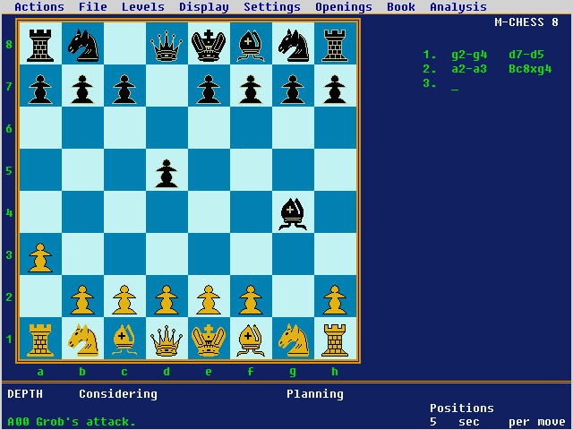

<h1 align="center">MChess Pro 8.0: UCI Compatible</h1>

<p align="center">
  <b>Marty Hirsch's world-champion chess program of the 1990s, reborn as a UCI engine in Zig:<br>the same search, the same evaluation, the same moves, at two million positions a second.</b>
</p>

<p align="center">
  
  
  
  
  
  
  
  
  <a href="LICENSE"></a>
</p>

<p align="center">
  
  <br>
  <sub>The original MChess Pro 8 for MS-DOS, running in this project's emulator.</sub>
</p>

---

**MChess** was written by **Marty Hirsch** and developed through the 1990s. In **1995** it won the **World Microcomputer Chess Championship** in Paderborn, and it earned a following for the way it played: sharp, tactical and happy to attack. **MChess Professional 8**, from 1998, is the version restored here.

This project takes that MS-DOS program apart and rebuilds it as a modern **UCI chess engine** written in **Zig**. It is not a new engine that plays "in the style of" MChess. It is MChess: the original's search and the original's evaluation, translated from the machine code and checked against the original program running in an emulator, **move for move and node for node**. Drop it into any chess GUI and one of the great programs of the DOS era plays again, on today's hardware.

## Contents

- [At a glance](#at-a-glance)
- [Speed](#speed)
- [Download and run](#download-and-run)
- [How it plays](#how-it-plays)
- [The philosophy of the rewrite](#the-philosophy-of-the-rewrite)
- [Inside the engine: search and evaluation](#inside-the-engine-search-and-evaluation)
- [Bugs corrected](#bugs-corrected)
- [UCI support](#uci-support)
- [Opening book and tablebases](#opening-book-and-tablebases)
- [Platforms](#platforms)
- [How we know it is faithful](#how-we-know-it-is-faithful)
- [Building from source](#building-from-source)
- [Credits and licence](#credits-and-licence)
- [Feedback](#feedback)

## At a glance

- **The real thing.** Same move generation and move order, same evaluation, same search, same hash tables. With the bug corrections switched off, it reproduces the original on all 700 recorded searches: the same move, the same node count, and the same sequence of moves tried inside the search.
- **Fast.** About 1.8 to 2.9 million nodes a second on a current laptop, on one thread.
- **A proper UCI engine.** Every `go` command, Fischer increments, moves-to-go, pondering, analysis of any legal position, full `info` output with mates shown as mates.
- **One file.** The opening book and the endgame tablebases are inside the executable. There is nothing to install and no data folder.
- **38 bugs of the original corrected**, each one documented, including one that made the original play an illegal move.
- **Written in Zig** 0.17.1, with 441 tests.
- **About 2525 Elo** on the CCRL Blitz scale in first tests.

## Speed

The original was a 16-bit DOS program that reached its hash tables through a memory driver, one entry at a time. The rewrite makes exactly the same decisions in native code on a modern machine.

| | Nodes per second |
|---|---:|
| The original, in this project's DOS emulator | about 7,000 |
| **This rewrite** (Intel Core Ultra 9 285H, one thread) | **1,800,000 to 2,900,000** |

The rewrite's figures are 1.86 million nodes a second from the start position, 1.94 million in a Sicilian middlegame and 2.89 million in a rook ending. The emulator's figure was measured on the same machine; the emulator executes the original one instruction at a time, so it is slow by nature. Given the same position and depth, and with the bug corrections off, both visit exactly the same positions. Only the time differs.

## Download and run

1. Download the executable for your platform from the [Releases](../../releases) page (see [Platforms](#platforms)). On Windows 10 and 11 take `mchess-windows-x64.exe`; on Windows 7 and 8, `mchess-windows7-x64.exe`.
2. Add it to your chess GUI as a UCI engine. It has been run in the Shredder and HIARCS GUIs and under `cutechess-cli` and `fastchess`.
3. Play.

That is all. The engine is one file of about 24 MB that needs nothing else.

It identifies itself as:

```text
id name MChess Pro 8
id author Marty Hirsch
```

### Options

| Option | Default | Range | What it does |
|---|---|---|---|
| `Hash` | 60 | 1 to 60 MB | The original's own hash-table setting. 60 MB is the most the original could use, so it is the most offered. |
| `OwnBook` | `false` | | Play from the original's opening book. Off by default, so that engine tournaments use their own openings. |
| `Book` | `Tournament` | `Tournament`, `Standard`, `Variety` | The original's three book modes. Used only with `OwnBook` on. |
| `Use Tablebases` | `true` | | Use the built-in endgame tablebases, as the original does. They are never used in `go infinite`, so analysis always searches. Set to `false`, it also gives back the memory they hold. |
| `Seed` | −1 | −1 to 65535 | Seed for the book's random choice. −1 takes it from the clock; any other value makes book play repeatable. |
| `Ponder` | `false` | | Tells the GUI that pondering is available. |
| `Move Overhead` | 30 | 0 to 5000 ms | Time kept back on each move for GUI and network delay. |

## How it plays

MChess had a style people remembered. It plays active, tactical chess and goes for the initiative, and descriptions of the time credited it with "unique algorithms to detect long-range tactics". Now that the program has been taken apart, we can say where that came from: see [Inside the engine](#inside-the-engine-search-and-evaluation).

All of it is preserved, strengths and weaknesses alike. Where the original misjudges a position, so does this engine. That is the point: this is a restoration, not an improvement.

**Playing strength.** A first test of 750 games at 10 seconds + 0.1 a move, against three versions of Stash with known ratings, puts it at **about 2525 Elo on the CCRL Blitz scale**, with a realistic range of 2490 to 2565 ([details](docs/MChess%20Strength%20Test.md)). That is on modern hardware, searching far deeper than it ever could in 1998. It is an early figure from fast games, and more results are very welcome (see [Feedback](#feedback)).

## The philosophy of the rewrite

**Same moves, same node count.** That is the rule everything else follows from. Given the same position, the same settings and the same depth, the rewrite must choose the same move as the original *for the same reasons*: it must try the same moves in the same order and visit the same number of positions.

It is **not** a byte-for-byte copy. The rewrite keeps every algorithm, every evaluation term, every table and every quirk of the search, and is free in *how* it computes them. A loop that cleared memory one entry at a time becomes a single fill; a call to a DOS memory driver becomes an array index; a hash entry is fetched ahead of use. Anything that would change a single node count is not allowed.

Three things are deliberately different:

- **Bugs are corrected** ([below](#bugs-corrected)): anything that crashed, corrupted memory, made the search unrepeatable or produced an illegal move, and the coding slips that plainly were not what the author meant. Each correction has its own switch in the source, so the engine can still be built exactly as the original behaved.
- **It speaks UCI.** The original's screen, menus, keyboard and mouse are gone.
- **Time management is modern.** The original's own time allocation suits the hardware of 1998. Here a modern time manager decides only *when to stop* the original's search; it never changes what the search does.

Everything else stays, including weak play, odd evaluation and the occasional chess misconception. A design choice we disagree with is not a bug.

## Inside the engine: search and evaluation

What made MChess special? For years that could only be guessed at from how it played. Disassembled, the program answers for itself. Much of it is the standard machinery of its day. What stands out is where the effort goes: a **plan drawn up at the root** of every search, a **selective search that chases checks and threats** well past the nominal depth, and a very large routine that **looks for tactical trouble without searching**.

Scores below are in pawns. Inside the program a pawn is worth 200 points.

### The search

The framework is conventional and tidy:

- **Iterative deepening** with an **aspiration window** that is not symmetrical: one pawn below the last score, 0.6 of a pawn above it.
- **Alpha-beta with principal-variation search**: the first move gets the full window, the rest a null window and a re-search if they beat it.
- **Null move**, reducing by two plies (one when little material is left). It is tried only after a quick staged evaluation says the position is good enough, never in check, and never without pawns or with almost no pieces.
- **Two hash tables**, one for White to move and one for Black, with 10-byte entries and depth-preferred replacement. There is no ageing: the tables are cleared before most searches.
- **Static exchange evaluation** on every capture as it is generated. It knows about pins (a pinned defender does not count) and about batteries (a queen in front of a rook, a bishop behind a queen).
- **Mates** are scored by distance, and a position's score is halved once 40 moves have passed without a capture or pawn move, so the program feels the 50-move rule coming.

The parts that are less ordinary:

**Every root move is examined before the search starts.** Each is made on the board and scored: a checking move by a full search of the replies, the others by the complete evaluation, threat detector included. That gives the first iteration its order, and the list is re-sorted after every iteration.

**Forcing lines run deep.** Every check in the full-width search extends it by a ply. If the check leaves only one or two legal replies, it extends by a second ply. There is a further extension in pawn endings.

**Move ordering without a history table.** The hash move comes first, then captures that do not lose material, ordered by what they win. Quiet moves are ordered by "marks": a killer move, or a quiet move that was best at some node, leaves a mark on its from-and-to squares, and the mark fades each time it is used. Everything else follows in generation order, centre pawns first. There are no late-move reductions: at a full-width node every move is searched to full depth.

**The selective search is in layers.** This is the heart of the tactical style. Past the nominal depth most programs of the time, and many since, look at captures only. MChess narrows down gradually, using four different move generators:

| Plies past the nominal depth | Moves it tries |
|---|---|
| 1 and 2 | Captures; checks, including discovered checks; promotions and advances of far-advanced pawns; pawn pushes that attack a piece |
| 3 and 4 | The same kinds of move, without those that lose material |
| 5 and 6 | Captures that do not lose material, and safe checks |
| Beyond | Winning captures and promotions |

A side in check always gets every legal reply, however deep. So a line of checks and threats is followed six plies beyond the depth on the display, and a line of captures as far as it goes.

**It looks for attacking patterns.** Before generating the tactical moves, the search checks for a few known shapes: an enemy queen that has reached b2 or g2 beside the king, a queen on h6 against a king on g8 or h8, a pawn or bishop on f6 or h6, a piece pinned against a king on its back rank. When it finds one it tells the move generator which squares matter, so that the quiet move that completes the attack is tried.

**The selective search can change its mind.** If the tactical moves have been tried and the position still looks dangerous (the threat detector has raised a flag, or material has changed and the score is close to the root's), the node is searched again with *every* move, at full width, in the middle of what other programs would call the quiescence search.

**Evaluation in stages.** The search never computes more of the evaluation than it needs. It starts with the cheapest part and stops as soon as the score is far outside the window, with margins of 1.6, 1.2 and 0.8 pawns as each part is added. And before any position is allowed to stand with a good score, the threat detector is asked whether the side to move is about to lose something.

### The evaluation

**The plan is made at the root.** Before every search about 20 KB of code rebuilds the piece-square tables for both sides from the position on the board. It decides the phase of the game by counting undeveloped pieces and castling rights. It looks at where the kings are and whether they can still castle, at the pawn structure, the passed pawns, blocked wings, outposts and half-open files, and at how far each square is from each king. The search then keeps running totals of those tables, which costs almost nothing per move. The same position can therefore score differently depending on where the search began: the program judges a position in the light of the game it is actually playing. Root preparation of this kind was a known technique of the period. MChess takes it a long way, and then adds a full evaluation of the position on top.

That evaluation, in the order the stages add it:

1. **Material and the root-built square values**, kept up to date move by move.
2. **Passed pawns.** A separate 16 KB routine that runs only when a passed pawn is on the board: pawn races, blockaders, the kings' distances, and specific endings such as queen against a pawn on the seventh or two knights against a pawn. It can declare a position drawn.
3. **Kings and pieces.**
   - *King safety* in four versions, chosen by how much material the opponent has left: the pawn shelter, open and half-open files beside the king, holes left by a missing fianchetto bishop, and the prospect of castling, which is marked down when an enemy bishop or queen covers the squares the king must cross.
   - *Development:* pieces shut in at home by their own pawns and pieces are penalised.
   - *Rooks* on open and half-open files, valued by how far the file is from the enemy king, and a penalty for a rook trapped beside a king that has lost the right to castle.
   - *Knights* on outposts, graded by rank and pawn support, and worth more the more pawns their side has.
   - *Bishops:* the bishop pair, pawns on the bishop's own colour, and a detailed catalogue of trapped bishops (the bishop that takes on h7 or a7 and is shut in by a pawn, and its relatives on g6, a6 and b7), with different penalties depending on whose move it is.
   - *Opposite-coloured bishops* reduce the advantage of the side that is ahead.
4. **Pawn structure**, in hand-written assembly: doubled, isolated, backward and passed pawns, and space, cached in a small pawn hash table.
5. **Piece activity**, also hand-written assembly. It walks every line of every bishop, rook and queen and every jump of every knight, adding the value of each square reached. Squares covered by enemy pawns do not count. It sees *through* pieces: a bishop or rook aimed at a knight with a rook, queen or king behind it is rewarded, as are pieces lined up on the enemy king's files and diagonals, rooks behind passed pawns and doubled rooks.

**The threat detector.** This is the most unusual part of the program, and our best candidate for the "long-range tactics" of the old descriptions. It is about 4,000 machine instructions for each colour, and it asks one question: *is the side to move in tactical trouble that a search this shallow would miss?* It looks for:

- **Mating attacks by the queen** on the squares beside the king. It lifts the queen off the board and runs the exchange evaluation on the mating square.
- **Back-rank mates** by a rook, on the first rank or along the second.
- **Batteries** set up for a discovered check.
- **A queen that is pinned or skewered**, or attacked with nowhere safe to go.
- **Each rook, knight and bishop in turn:** is it pinned, is it attacked, and has it a safe square? Every retreat is tried with the exchange evaluation, so a trapped piece is found without searching a move.
- **An attacked pawn shield**, centre pawns under fire, and weak pawns attacked in the ending.

The penalties run from a fraction of a pawn to 25 pawns, which in practice means "this loses", and they are heaviest in the full-width search and the first plies beyond it, and lighter deep in the selective search. The same idea works for the attacker: the side to move gets a bonus for attacking enemy pieces with cheaper ones, small for one piece, 1.5 pawns for two and more for three. A fork is worth something before it is cashed.

**In the endgame** the king tables change with the material left; there are special rules for pawn endings in which the defending king holds the pawns up, the rook's pawn among them; and the side that is ahead is paid a little more as pieces come off and a little less for every move that makes no progress.

**What it does not have:** a history table, late-move reductions, singular extensions, futility pruning in the modern sense, or more than one thread. And in the Normal playing style, the one this engine uses, there is no randomness anywhere in the search or the evaluation.

## Bugs corrected

Taking a program apart instruction by instruction finds things its author never saw. **38 logic bugs** of the original are corrected, plus **six reads of memory the program had never written**, **one buffer overflow** and **five illegal moves in the opening book**. Every one is recorded, with the original's code address and a test, in [`docs/DEVIATIONS.md`](docs/DEVIATIONS.md).

A bug, here, means a place where the code plainly fails to do what it was written to do. Much of MChess is written twice, once for White and once for Black, and the usual proof of a bug is the same routine for the other colour doing it correctly. The main ones:

- **The original could play an illegal move.** It keeps illegal moves out of its search by giving them a very low score. A side five or more queens down can have a legal move that scores lower still, and then an illegal one is played. In the emulator the original moved its king into check, and on the next move announced "Stalemate!!" with the king gone from the board.
- **Its search was not repeatable.** Two routines read stack memory they had never written, so the search tree depended on where DOS had loaded the program and on the timer. The same position could be searched differently from one run to the next.
- **A rook captured on its corner kept its castling right** inside the search, so the program could plan to castle with a different rook that later reached the corner.
- **The hash key was updated on the wrong square for en passant**, so positions reached by an en-passant capture were stored under the wrong key.
- **A mate in one could be scored as a draw** in pawnless endings that the tablebases do not cover.
- **A sign error in root move ordering** affected every search in which the program played Black.
- **White and Black were not evaluated alike.** In several places the code for one colour differs from the code for the other. A position and its mirror image now get the same evaluation in all but a few documented cases.
- **A position with more than 100 possible moves** overwrote memory past the end of the move list.

Because the original's search was not repeatable, the comparison is made against the original with those stray memory reads pinned to the values the code evidently meant.

**Want the uncorrected original?** The source builds a second engine, `mchess-original`, with every logic correction off. It is the engine the comparison with the original proves.

## UCI support

The engine aims to support the whole UCI protocol.

- **Every `go` form:** `depth`, `nodes`, `movetime`, `wtime`/`btime` with `winc`/`binc` (Fischer increments), `movestogo` (classical time controls), `mate`, `infinite` and `ponder`.
- **Any legal position**, from `startpos` or a FEN, including the short FENs some GUIs send. A position no game could reach (the side to move in a check that no legal move could have given, for example) is refused with a clear reason instead of being searched.
- **Full feedback while it thinks:** `depth`, `seldepth`, `score cp` or `score mate`, `nodes`, `nps`, `time`, `hashfull`, `pv`, `currmove`. Scores are in pawns, as the original displayed them.
- **`go depth N`** (1 to 30) runs the original's "Fixed depth" level exactly. Every other `go` runs the same search and lets the time manager stop it.
- **`isready`** is answered at once, even in the middle of a search.

What it does not do: `searchmoves` is accepted but ignored; there is no `MultiPV` and no `Threads`, because the original searches one line on one processor; and pondering runs an ordinary search of the expected position rather than the original's own way of thinking on the opponent's time. Full details are in [`docs/UCI.md`](docs/UCI.md).

## Opening book and tablebases

Both are **built into the executable** and unpacked in memory when the engine starts. Nothing is read from disk.

- **The opening book** is the original's, by **Sandro Necchi**: about 390,000 positions. It is off by default; set `OwnBook` to use it. Five of its moves are illegal in the positions they are given for; the engine treats each as "out of book" and searches.
- **The endgame tablebases** are the original's three- and four-man tables: 66 files. They are unpacked at start-up, which takes about 0.2 seconds and about 310 MB of memory; turning `Use Tablebases` off releases about 230 MB of it. Two of the original set, `KPPK` and `KPKP`, are left out because they are wrong in about 14% of positions.

As in the original, the tablebases decide the move at the root when few men are left. In `go infinite` they are ignored, so that analysis shows a searched line.

## Platforms

All builds are optimised release builds of the same engine.

| File | Platform | Status |
|---|---|---|
| `mchess-windows-x64.exe` | Windows, 64-bit Intel and AMD | **Fully tested**: the whole test suite, protocol tests, stress tests and about 13,000 games |
| `mchess-windows-x86.exe` | Windows, 32-bit | Run: the same node counts as the 64-bit build, a few percent slower |
| `mchess-windows-arm64.exe` | Windows on ARM | Compiled, not yet run |
| `mchess-windows7-x64.exe` | Windows 7 and 8, 64-bit | Run on Windows 11: the whole test suite, protocol tests, stress tests, 700 games, and the same moves and node counts as the standard build. Not yet run on Windows 7 itself |
| `mchess-windows7-x86.exe` | Windows 7 and 8, 32-bit (also runs on 64-bit Windows) | The same |
| `mchess-macos-arm64` | macOS on Apple silicon | Compiled, not yet run |
| `mchess-linux-x64` | Linux, 64-bit Intel and AMD | Compiled, not yet run |
| `mchess-linux-arm64` | Linux, 64-bit ARM (a Raspberry Pi, for instance) | Compiled, not yet run |
| `mchess-android-arm64` | Android, 64-bit ARM | Compiled, not yet run |

The untested builds come from the same source through Zig's cross-compiler, and nothing in the engine depends on the operating system beyond input, output, the clock and threads. They should work. If you run one, please say how it went.

**Windows 7 and 8.** The standard Windows builds need Windows 10 or later, because the Zig standard library they are built on does. The two `windows7` builds, on the Releases page since 25 November 2026, are the same engine on a small layer of their own for threads, locks, the clock and input and output, using only what Windows 7 provides (`src/win7_io.zig`). They play the same moves, with the same node counts. Each has been checked to import nothing that Windows 7 lacks, but neither has yet been run on a Windows 7 machine: if you try one, a report would be welcome. On Windows 10 and 11, use the standard builds. Details are in [`docs/UCI.md`](docs/UCI.md#windows-7-build).

## How we know it is faithful

"It looks right" is not evidence. The original program runs in an emulator written for this project, driven through its own keyboard interface, and what it does is recorded and compared.

| Recorded from the original | Searches | Result |
|---|---:|---|
| Fixed-depth searches from games and set-up positions | 295 | all equal |
| Normal play against typed moves, including 37 replies to check | 107 | all equal |
| Positions with castling rights | 38 | all equal |
| Play out of the opening book, all three book modes | 31 | all equal |
| Endgames, tablebases on and off | 136 | all equal |
| Each hash-table size | 28 | all equal |
| Games near the original's 201-move limit | 8 | all equal |
| Deep searches, depths 5 to 30, up to 5.8 million nodes | 23 | all equal |
| Rare code paths and extreme positions | 34 | all equal |
| **Total** | **700** | **all equal** |

"Equal" means the same move, the same node count, the same number of moves made, and the same hash of every move the search tried, in order. Beyond that:

- Every routine was also compared on its own, on calls recorded from the original: 523,705 calls of the move-making routine, for example, with every byte of state checked.
- Move generation matches the rules of chess on all 743 perft test positions.
- About 13,000 self-play games, at controls from half a second for the whole game upwards, found two faults early on, both fixed, and since then no crash and no illegal move. One game was lost on time; its cause is fixed.
- A stress harness throws malformed input, extreme positions and every `go` parameter at the engine and checks every move it prints for legality: about 66,000 best moves and 1.2 million moves of analysis lines in a run.

## Building from source

The source is here to read. It is Zig 0.17.1, in `src/`, with a comment on every ported routine giving the address of the original code it came from.

Building it needs more than this repository holds. The build takes the evaluation tables, the opening book and the tablebases directly from an original copy of MChess Pro 8, so that nothing is retyped by hand, and the original program's files are not published here. The tests, likewise, compare against recordings of the original that are not in the repository. **To run the engine, use the released executables.**

## Credits and licence

- **MChess** is the work of **Marty Hirsch**. All of the chess in this engine is his.
- The **opening book** is by **Sandro Necchi**.
- The rewrite is by **Steve Maughan**, 2026. The time manager is taken from his engine Juggernaut, and the method from the sibling project [Cyrus IS Chess](https://github.com/stevemaughan/Cyrus-IS-Chess).

**Licence.** The rewrite is free for any non-commercial purpose, under the [PolyForm Noncommercial License 1.0.0](LICENSE): © 2026 Steve Maughan. It is based on MChess Professional 8, © 1998 Marty Hirsch. The licence covers the rewrite only, and grants no right in the original program, its opening book (© 1998 Sandro Necchi) or its other data.

## Feedback

Test results are wanted: tournament and rating-list results, games at longer time controls, and reports from the platforms not yet run. Bug reports are welcome too, with one request: before reporting weak or strange play, remember that this engine is meant to play exactly as MChess Pro 8 did. If the original would have played it, it is not a bug.

Please open an issue on this repository.
